# Implementation Google-Net+ Alex-net Overfitting Reduce Techniques

This folder holds the implementation of AlexNet and GoogLeNet for counterfeit medicine packaging classification, built to demonstrate overfitting reduction techniques. The work compares an unregularized AlexNet against a regularized AlexNet, then implements a simplified GoogLeNet with Inception modules. Supporting outputs from the Counterfeit Medicine Detection pipeline and a web feedback logger are included as well.

- Main notebook: [Automated_Counterfeit_Pharmaceutical_Detection_using_Deep_Learning.ipynb](Automated_Counterfeit_Pharmaceutical_Detection_using_Deep_Learning.ipynb)
- Exported report: [Counterfeit_Medicine_Detection.pdf](Counterfeit_Medicine_Detection.pdf)
- Extracted plots: [figures/](figures)
- Result files and tables: [results/](results)
- Feedback records: [Feedback/](Feedback)

Models covered in this folder:

| Model | Role |
| --- | --- |
| AlexNet (baseline, unregularized) | Overfitting reference model |
| AlexNet (regularized) | Overfitting reduction model |
| GoogLeNet (Inception modules) | Second architecture |
| EfficientNet-B0 | Supporting results in `results/efficientnet_b0` |
| MobileNetV2 | Supporting results in `results/mobilenet_v2` |

## Table of Contents

1. [Overview](#1-overview)
2. [Dataset](#2-dataset)
3. [Data Pipeline and Augmentation](#3-data-pipeline-and-augmentation)
4. [Part 1: AlexNet and Overfitting Reduction](#4-part-1-alexnet-and-overfitting-reduction)
5. [Part 2: GoogLeNet](#5-part-2-googlenet)
6. [Evaluation and Diagnostics](#6-evaluation-and-diagnostics)
7. [Counterfeit Medicine Detection Results](#7-counterfeit-medicine-detection-results)
8. [Web Feedback Logger](#8-web-feedback-logger)
9. [Figure Reference](#9-figure-reference)
10. [File Reference](#10-file-reference)

---

## 1. Overview

The notebook runs a single reproducible pipeline (seed 42) on TensorFlow 2.21.0 with a GPU device. The pipeline covers data loading, class imbalance measurement, augmentation, two model families, threshold analysis, and deployment. The overfitting study is a controlled comparison:

1. Baseline AlexNet: trained without data augmentation, without Dropout, and without weight decay.
2. Regularized AlexNet: trained with in-graph augmentation, Dropout (0.5), L2 weight decay (1e-4), and EarlyStopping.

A simplified GoogLeNet is then trained on the same pipeline to compare a multi-scale feature extractor against the single-scale AlexNet design.

---

## 2. Dataset

The dataset is retrieved with KaggleHub from `surajkumarjha1/fake-vs-real-medicine-datasets-images`. Images are grouped into `Fake` and `Real` classes. The class index follows alphabetical order: `0` = Fake, `1` = Real.

The notebook reports 661 training files and 449 test files across two classes. The stored split summary in [results/dataset_distribution.csv](results/dataset_distribution.csv) gives the full three-way split used by the Counterfeit Medicine Detection pipeline:

| Split | Fake | Real | Total |
| --- | ---: | ---: | ---: |
| Train | 240 | 422 | 662 |
| Val | 167 | 287 | 454 |
| Test | 162 | 288 | 450 |

The training split is imbalanced. The measured training imbalance ratio is 1.76 to 1 (Real to Fake), which is handled with balanced class weights during training.

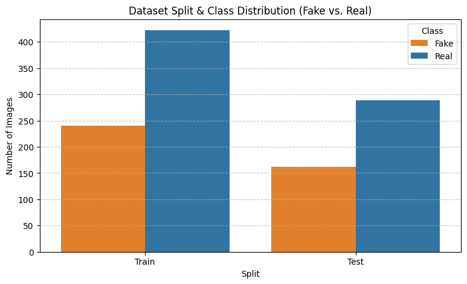

The chart shows the Fake and Real image counts for the Train and Test splits, grouped by split.

Raw packaging samples are inspected before any transformation to verify label alignment and packaging appearance.

The grid shows twelve raw training images with their class label above each image.

---

## 3. Data Pipeline and Augmentation

Images are resized to 224 x 224 and loaded in batches of 16 with `label_mode="binary"`. The pipeline caches and prefetches with `tf.data.AUTOTUNE`.

Augmentation is applied inside the model so that inference stays self-contained. The block used in the notebook is:

| Layer | Setting | Purpose |
| --- | --- | --- |
| RandomFlip | horizontal | Handheld capture angle |
| RandomRotation | 0.05 (about plus or minus 18 degrees) | Tilt |
| RandomZoom | 0.10 (about plus or minus 10 percent) | Distance |
| RandomBrightness | 0.10 on [0, 255] | Lighting variation |
| RandomContrast | 0.10 | Exposure variation |

After augmentation, inputs are rescaled to the [0, 1] range with `Rescaling(1/255)`. The Counterfeit Medicine Detection pipeline adds two more steps: `RandomSaturation(0.15)` and a second `Rescaling(2, -1)` that maps inputs to [-1, 1]. Both steps are recorded in [results/pipeline_info.json](results/pipeline_info.json).

The figure has four rows and three columns. The top row shows the original images with their class label. The three lower rows show random augmented versions of the same images.

---

## 4. Part 1: AlexNet and Overfitting Reduction

### 4.1 Architecture

Both AlexNet variants share the same convolutional stack. They differ only in regularization.

- Input: 224 x 224 x 3.
- Conv block 1: Conv2D 64 filters, 7 x 7, stride 2, then MaxPool 3 x 3, stride 2.
- Conv block 2: Conv2D 128 filters, 5 x 5, then MaxPool 3 x 3, stride 2.
- Conv blocks 3, 4, 5: Conv2D 256, Conv2D 256, Conv2D 128 (all 3 x 3), then MaxPool 3 x 3, stride 2.
- Head: Flatten, Dense 256 with ReLU, Dense 128 with ReLU, Dense 1 with sigmoid output.

Regularization applied only in the regularized model:

- BatchNormalization after each convolution and each dense layer.
- Dropout 0.5 after both dense layers.
- L2 weight decay with factor 1e-4 on all convolutions and dense layers.
- In-graph data augmentation before the first convolution.

The baseline model uses no BatchNormalization, no Dropout, and no weight decay.

### 4.2 Training Configuration

- Loss: binary crossentropy.
- Epochs: 15.
- Class weights: balanced weights computed from the Fake and Real training counts.
- Baseline optimizer: Adam, learning rate 0.001, `clipnorm=1.0`.
- Regularized optimizer: Adam with a CosineDecay schedule, initial learning rate 1e-4, warmup target 1e-3 over 2 epochs, decay across 15 epochs, `clipnorm=1.0`.
- Regularized model callback: EarlyStopping on `loss` with patience 4 and best weight restore.
- Note: the notebook fits both models on the training set only. No validation split is passed during fit, so the training history contains training loss and training accuracy only.

### 4.3 Baseline versus Regularized Training

Training accuracy at the start and end of the 15 epochs:

| Model | Epoch 1 accuracy | Epoch 15 accuracy | Epoch 1 loss | Epoch 15 loss |
| --- | ---: | ---: | ---: | ---: |
| Baseline AlexNet | 0.5446 | 0.8971 | 0.8889 | 0.2436 |
| Regularized AlexNet | 0.7489 | 0.9032 | 0.7441 | 0.4020 |

Observed behaviour from the printed logs:

- The baseline loss is unstable. It rises at several epochs (0.7529 at epoch 4, 0.7384 at epoch 7, 0.6414 at epoch 10) before falling, which is consistent with a model without normalization or regularization.
- The regularized loss decreases steadily with only small fluctuations, which is consistent with BatchNormalization and Dropout stabilizing the updates.
- The regularized accuracy curve rises faster early on because BatchNormalization and augmentation produce smoother gradients.

The figure has two panels. The left panel plots training loss against epochs. The right panel plots training accuracy against epochs. Only training curves are shown, because no validation set was passed to `fit`.

### 4.4 Test Results

Evaluation on the held-out test set:

| Model | Test loss | Test accuracy |
| --- | ---: | ---: |
| Baseline AlexNet | 0.2022 | 94.43% |
| Regularized AlexNet | 0.3214 | 93.10% |

Both models reach a similar accuracy band on this test split. The baseline scores slightly higher accuracy, while the regularized model gives a lower-variance training trajectory. On this particular split the regularization did not translate into a higher test accuracy, which is reported here as measured.

---

## 5. Part 2: GoogLeNet

### 5.1 Inception Module

The Inception module computes four parallel branches on the same input and concatenates their outputs along the channel axis:

- Branch 1: 1 x 1 convolution.
- Branch 2: 1 x 1 convolution followed by 3 x 3 convolution.
- Branch 3: 1 x 1 convolution followed by 5 x 5 convolution.
- Branch 4: 3 x 3 max pooling followed by 1 x 1 convolution.

Every convolution is followed by BatchNormalization and ReLU. Concatenating the branches lets the network read the medicine packaging at several spatial scales at once.

### 5.2 Architecture and Parameters

- Stem: Conv 7 x 7, 64 filters, stride 1, then MaxPool 3 x 3, stride 2.
- Then Conv 1 x 1, 64 filters and Conv 3 x 3, 192 filters, then MaxPool 3 x 3, stride 2.
- Inception block 1 with filters [64, 96, 128, 16, 32, 32].
- Inception block 2 with filters [128, 128, 192, 32, 96, 64].
- Then MaxPool 3 x 3, stride 2.
- Head: GlobalAveragePooling2D, Dropout 0.4, Dense 1 with sigmoid output.

Parameter count from the printed model summary:

| Item | Value |
| --- | ---: |
| Total parameters | 681,313 (2.60 MB) |
| Trainable parameters | 678,657 (2.59 MB) |
| Non-trainable parameters | 2,656 (10.38 KB) |

The optimizer and loss match the regularized AlexNet setup: Adam with CosineDecay warmup, `clipnorm=1.0`, and binary crossentropy, with EarlyStopping on `loss` (patience 4).

### 5.3 Training and Test Results

Training progressed from accuracy 0.7821 and loss 0.4995 at epoch 1 to accuracy 0.9304 and loss 0.1717 at epoch 15. The test evaluation gives loss 0.3792 and accuracy 83.74%.

A clean evaluation of the training set in inference mode (augmentation and Dropout turned off) gives loss 0.3704 and accuracy 84.11%. The closeness of the clean training accuracy and the test accuracy indicates the model is not strongly memorizing the training set under inference settings.

The figure has two panels. The left panel plots GoogLeNet training loss against epochs. The right panel plots GoogLeNet training accuracy against epochs.

---

## 6. Evaluation and Diagnostics

The diagnostics below are computed on the GoogLeNet model. The positive class for the default report is Real (label 1). For safety-oriented analysis the labels are inverted so that Fake becomes the positive class, and the threshold is tuned on that basis.

### 6.1 Default Confusion Matrix

At the default threshold of 0.50, the classification report is:

| Class | Precision | Recall | F1-score | Support |
| --- | ---: | ---: | ---: | ---: |
| Real | 0.9496 | 0.7875 | 0.8610 | 287 |
| Fake | 0.7109 | 0.9259 | 0.8043 | 162 |
| Accuracy | | | 0.8374 | 449 |
| Macro average | 0.8302 | 0.8567 | 0.8326 | 449 |
| Weighted average | 0.8635 | 0.8374 | 0.8405 | 449 |

In counts, the confusion matrix at threshold 0.50 is:

| Actual, Predicted | Predicted Fake | Predicted Real |
| --- | ---: | ---: |
| Actual Fake | 150 | 12 |
| Actual Real | 61 | 226 |

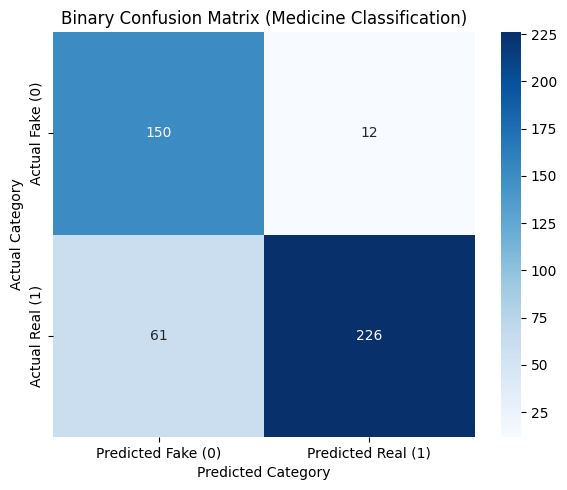

The heatmap shows the four counts above, with Actual Fake and Actual Real as rows and Predicted Fake and Predicted Real as columns.

### 6.2 ROC and Precision-Recall Curves

The ROC curve and the Precision-Recall curve are plotted for the Real class. The ROC curve compares the true positive rate against the false positive rate, and the PR curve compares precision against recall. The area values are shown in each legend.

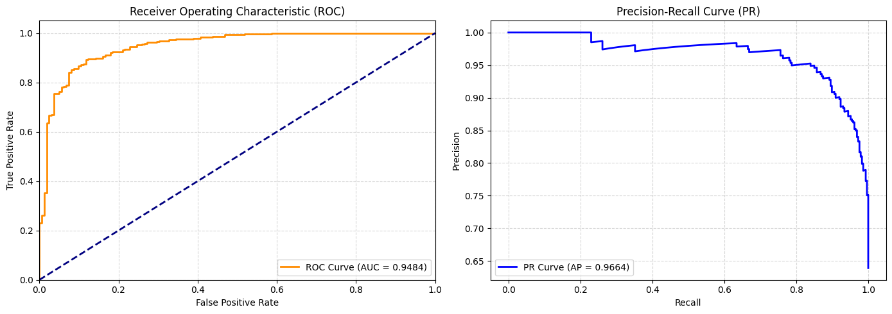

The figure has two panels. The left panel is the ROC curve with the diagonal chance line. The right panel is the Precision-Recall curve.

### 6.3 Decision Threshold Tuning

Because a missed counterfeit is the costly error, the labels are inverted so that Fake is the positive class, and precision, recall, and F1 are computed across thresholds from 0.01 to 0.99.

- Optimal threshold for Fake detection: 0.653
- Metrics at that threshold: Precision 0.821, Recall 0.877, F1 0.848

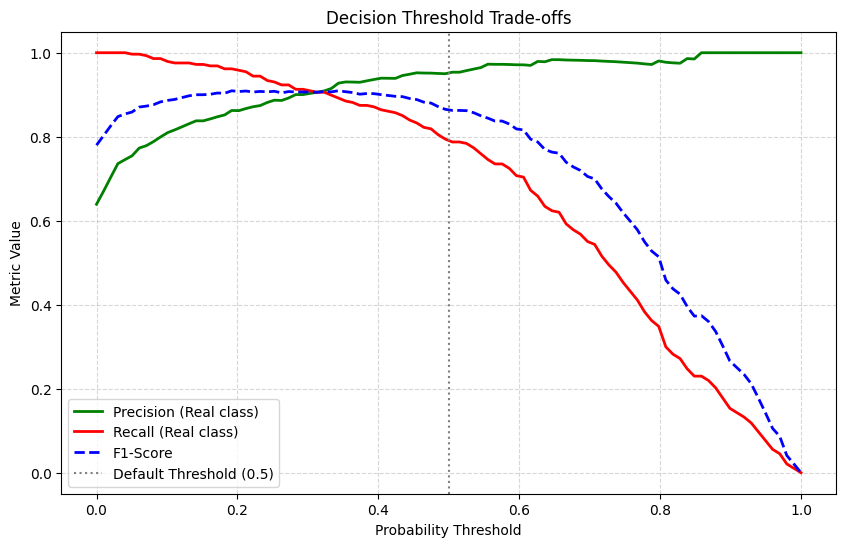

The figure plots precision, recall, and F1 for the Real class against the threshold, with a vertical line at the default threshold of 0.5.

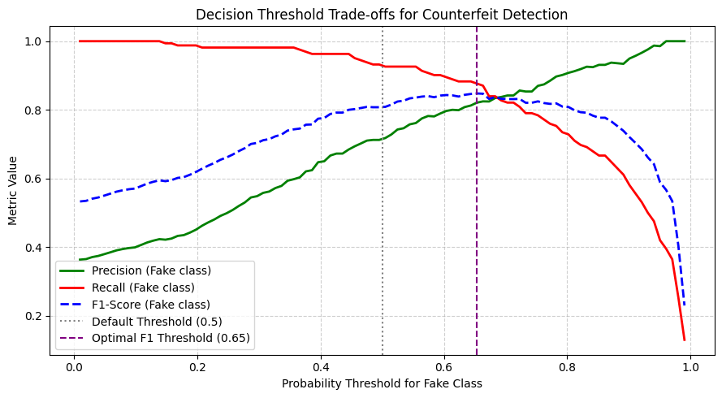

The figure plots precision, recall, and F1 for the Fake class against the threshold, with vertical lines at the default threshold of 0.5 and at the optimal F1 threshold of 0.65.

The corrected ROC and PR curves for the Fake class include the minority class baseline, which is the Fake share of the test set: 162 / 450, about 0.36.

The figure has two panels. The left panel is the ROC curve for the Fake class with the chance line. The right panel is the Precision-Recall curve for the Fake class with a horizontal minority baseline.

### 6.4 Final Threshold Comparison

The confusion matrix and metrics are compared at the default threshold of 0.50 and at the tuned threshold of 0.65, with Fake as the positive class.

At threshold 0.50:

| Class | Precision | Recall | F1-score | Support |
| --- | ---: | ---: | ---: | ---: |
| Real | 0.9496 | 0.7875 | 0.8610 | 287 |
| Fake | 0.7109 | 0.9259 | 0.8043 | 162 |
| Accuracy | | | 0.8374 | 449 |

At threshold 0.65:

| Class | Precision | Recall | F1-score | Support |
| --- | ---: | ---: | ---: | ---: |
| Real | 0.9275 | 0.8920 | 0.9094 | 287 |
| Fake | 0.8208 | 0.8765 | 0.8478 | 162 |
| Accuracy | | | 0.8864 | 449 |

Raising the threshold to 0.65 lifts overall accuracy from 0.8374 to 0.8864 and lifts Fake precision from 0.7109 to 0.8208, at the cost of a small drop in Fake recall from 0.9259 to 0.8765.

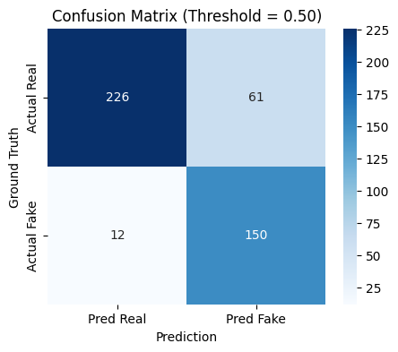

The heatmap shows the predictions at the default threshold of 0.50 with Real and Fake as rows and columns.

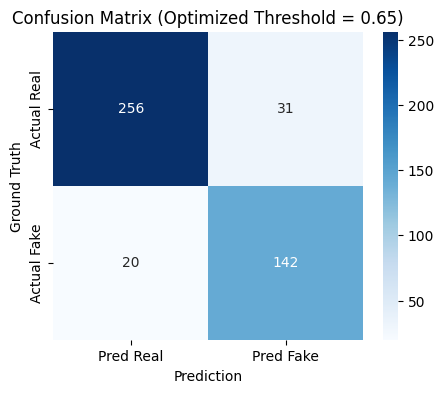

The heatmap shows the predictions at the tuned threshold of 0.65 with Real and Fake as rows and columns.

### 6.5 Qualitative Predictions

A batch of test images is displayed with the true label, the predicted label, and the confidence. Correct predictions are titled in green and incorrect predictions in red.

The gallery is a grid of test images, each titled with the true class, the predicted class, and the confidence percentage.

---

## 7. Counterfeit Medicine Detection Results

The `results` folder stores the outputs of the Counterfeit Medicine Detection pipeline, which uses EfficientNet-B0 as the primary model and MobileNetV2 for edge deployment. Both models use the same 224 x 224 input pipeline and a two-phase training schedule: a frozen-backbone feature extraction phase, then a fine-tuning phase.

### 7.1 Model Configuration

From [results/setup_summary.json](results/setup_summary.json) and [results/efficientnet_b0/model_info.json](results/efficientnet_b0/model_info.json):

| Setting | EfficientNet-B0 | MobileNetV2 |
| --- | --- | --- |
| Input size | 224 x 224 | 224 x 224 |
| Dense units | 256 | 128 |
| Dropout | 0.4 | 0.3 |
| Phase 1 learning rate | 1e-3 | 1e-3 |
| Phase 2 learning rate | 1e-5 | 1e-5 |
| Phase 1 epochs | 15 | 15 |
| Phase 2 epochs | 20 | 20 |
| Batch size | 32 | 32 |
| Pretrained | Yes (ImageNet) | Yes (ImageNet) |

EfficientNet-B0 uses BinaryFocalCrossentropy with gamma 2.0 and alpha 0.25. It unfreezes the last 30 backbone layers in Phase 2, has 4,377,764 total parameters, and 328,193 trainable parameters in Phase 1.

### 7.2 Dataset and Pipeline

The dataset distribution is given in [results/dataset_distribution.csv](results/dataset_distribution.csv) and shown in the Dataset section above. The pipeline is recorded in [results/pipeline_info.json](results/pipeline_info.json): image size 224 x 224, batch size 32, binary labels, 21 training batches, 15 validation batches, and 15 test batches per epoch.

The grid shows eighteen raw training images labelled Fake or Real, before any augmentation.

The figure shows an original image in the top row and three augmented versions below it, for three sample images.

### 7.3 EfficientNet-B0 Phase 1

Phase 1 training raises validation accuracy to 1.0 and validation AUC to 1.0. Reported metrics after Phase 1:

- Validation: loss 0.0020, accuracy 1.0000, AUC 1.0000
- Test: loss 0.0021, accuracy 1.0000, AUC 1.0000
- Test classification report: precision, recall, and F1 of 1.00 for both Fake (162 images) and Real (287 images)

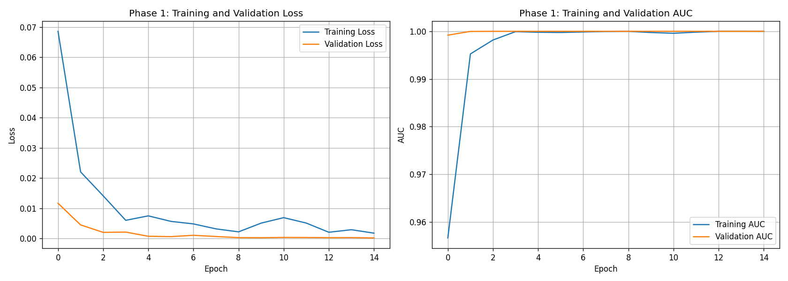

The figure has two panels. The left panel plots training and validation loss across the 15 Phase 1 epochs. The right panel plots training and validation AUC across the same epochs.

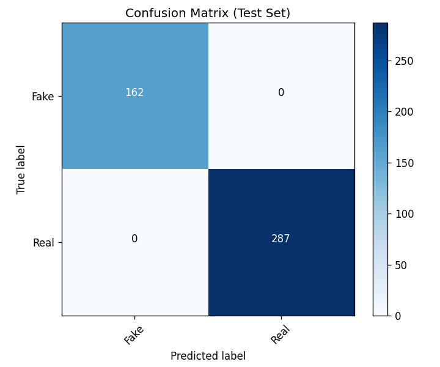

The heatmap shows the test-set confusion matrix for the Phase 1 model.

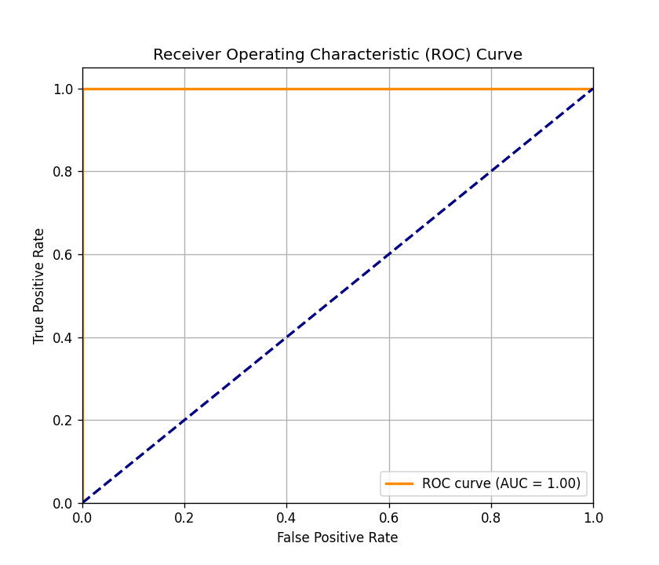

The curve plots the true positive rate against the false positive rate for the test set, with the AUC shown in the legend.

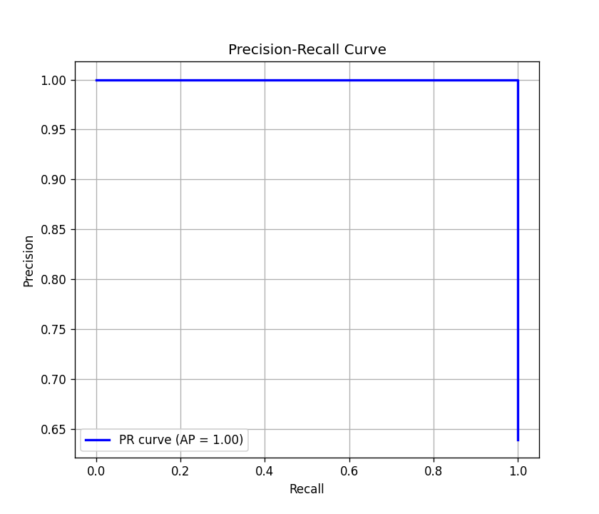

The curve plots precision against recall for the test set, with the average precision shown in the legend.

Phase 2 fine-tunes the last 30 backbone layers. It runs for 8 epochs and stops early, restoring the best weights from epoch 1, where validation accuracy was 1.0 and validation loss was 0.0022. Full per-epoch values are in [results/efficientnet_b0/history_phase1.csv](results/efficientnet_b0/history_phase1.csv) and [results/efficientnet_b0/history_phase2.csv](results/efficientnet_b0/history_phase2.csv).

### 7.4 MobileNetV2 Phase 1 and Phase 2

MobileNetV2 Phase 1 stops early after 5 epochs. Validation accuracy reaches 1.0 and validation AUC reaches 1.0, with validation loss 0.0022. Phase 2 runs for 7 epochs and stops early, reaching validation accuracy 0.9978, validation AUC 1.0, and validation loss about 0.0027. Full per-epoch values are in [results/mobilenet_v2/history_phase1.csv](results/mobilenet_v2/history_phase1.csv) and [results/mobilenet_v2/history_phase2.csv](results/mobilenet_v2/history_phase2.csv).

### 7.5 Final Model Comparison

From [results/final_model_comparison_report.csv](results/final_model_comparison_report.csv):

| Model | Accuracy | Fake Precision | Fake Recall | Fake F1 | Real Precision | Real Recall | ROC-AUC |
| --- | ---: | ---: | ---: | ---: | ---: | ---: | ---: |
| EfficientNet-B0 | 1.0000 | 1.0000 | 1.0000 | 1.0000 | 1.0000 | 1.0000 | 1.0000 |
| MobileNetV2 | 0.9933 | 0.9877 | 0.9938 | 0.9908 | 0.9965 | 0.9930 | 0.9999 |

EfficientNet-B0 reaches perfect scores on the test set. MobileNetV2 stays close behind while using a lighter architecture suited to edge deployment.

---

## 8. Web Feedback Logger

The notebook deploys a Gradio interface for single-image inference. The interface shows the probability of Fake and the probability of Real, plus two decisions: one at the standard threshold of 0.50 and one at an optimized safety threshold. When a user marks a prediction as incorrect, the image is saved to the Feedback folder and an entry is written to the log.

The log [Feedback/feedback_log.csv](Feedback/feedback_log.csv) records four entries. Each entry has a timestamp, the saved image path, the optimized prediction of Fake, and a feedback note that is empty in all four rows.

| Timestamp | Predicted | Note |
| --- | --- | --- |
| 20260927_214040 | Fake | (empty) |
| 20260927_214114 | Fake | (empty) |
| 20260927_214155 | Fake | (empty) |
| 20260928_182258 | Fake | (empty) |

The four saved images are packaging photos captured through the interface where the user flagged the prediction as incorrect.

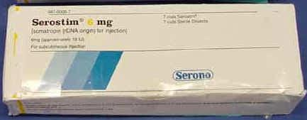

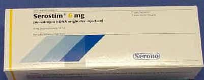

These images are the feedback samples used to inspect and correct errors in future training rounds.

---

## 9. Figure Reference

| Figure | Source | Description |
| --- | --- | --- |
| [01 dataset distribution](figures/01_dataset_distribution.png) | Notebook | Train and Test class counts by split |
| [02 sample packages](figures/02_sample_packages.png) | Notebook | Twelve raw training images with labels |
| [03 augmentation preview](figures/03_augmentation_preview.png) | Notebook | Original plus three augmented versions for three samples |
| [04 AlexNet history](figures/04_alexnet_regularized_history.png) | Notebook | Regularized AlexNet training loss and accuracy |
| [05 GoogLeNet history](figures/05_googlenet_history.png) | Notebook | GoogLeNet training loss and accuracy |
| [06 confusion matrix default](figures/06_confusion_matrix_default.png) | Notebook | Test confusion matrix at threshold 0.50 |
| [07 ROC and PR, Real class](figures/07_roc_pr_real_class.png) | Notebook | ROC and PR curves for the Real class |
| [08 threshold trade-offs, Real class](figures/08_threshold_tradeoff_real_class.png) | Notebook | Precision, recall, and F1 against threshold for Real |
| [09 qualitative predictions](figures/09_qualitative_predictions.png) | Notebook | Test images with true and predicted labels |
| [10 threshold trade-offs, Fake class](figures/10_threshold_tradeoff_fake_class.png) | Notebook | Precision, recall, and F1 against threshold for Fake |
| [11 ROC and PR, Fake class](figures/11_roc_pr_fake_class.png) | Notebook | ROC and PR curves for the Fake class with minority baseline |
| [12 confusion matrix at 0.50](figures/12_confusion_matrix_threshold_050.png) | Notebook | Test confusion matrix at threshold 0.50 |
| [13 confusion matrix at 0.65](figures/13_confusion_matrix_threshold_065.png) | Notebook | Test confusion matrix at threshold 0.65 |
| [sample images](results/sample_images.png) | Results | Eighteen raw training images for the medicine pipeline |
| [augmentation preview](results/augmentation_preview.png) | Results | Original and augmented medicine images |
| [EfficientNet Phase 1 history](results/efficientnet_b0/phase1_training_history.png) | Results | Loss and AUC across Phase 1 |
| [EfficientNet Phase 1 confusion matrix](results/efficientnet_b0/phase1_confusion_matrix.png) | Results | Test confusion matrix |
| [EfficientNet Phase 1 ROC](results/efficientnet_b0/phase1_roc_curve.png) | Results | ROC curve with AUC |
| [EfficientNet Phase 1 PR](results/efficientnet_b0/phase1_precision_recall_curve.png) | Results | Precision-Recall curve with average precision |
| [Feedback 20260927_214040](Feedback/misclassified_as_Fake_20260927_214040.jpg) | Feedback | Reported misclassification |
| [Feedback 20260927_214114](Feedback/misclassified_as_Fake_20260927_214114.jpg) | Feedback | Reported misclassification |
| [Feedback 20260927_214155](Feedback/misclassified_as_Fake_20260927_214155.jpg) | Feedback | Reported misclassification |
| [Feedback 20260928_182258](Feedback/misclassified_as_Fake_20260928_182258.jpg) | Feedback | Reported misclassification |

---

## 10. File Reference

| Path | Description |
| --- | --- |
| [Automated_Counterfeit_Pharmaceutical_Detection_using_Deep_Learning.ipynb](Automated_Counterfeit_Pharmaceutical_Detection_using_Deep_Learning.ipynb) | Main notebook with AlexNet, regularized AlexNet, GoogLeNet, diagnostics, and deployment |
| [Counterfeit_Medicine_Detection.pdf](Counterfeit_Medicine_Detection.pdf) | Exported report of the Counterfeit Medicine Detection pipeline |
| [results/dataset_distribution.csv](results/dataset_distribution.csv) | Fake and Real counts for Train, Val, and Test |
| [results/pipeline_info.json](results/pipeline_info.json) | Image size, batch size, augmentation layers, and preprocessing |
| [results/setup_summary.json](results/setup_summary.json) | Dataset paths, class counts, and model configurations |
| [results/final_model_comparison_report.csv](results/final_model_comparison_report.csv) | Final comparison of EfficientNet-B0 and MobileNetV2 |
| [results/efficientnet_b0/model_info.json](results/efficientnet_b0/model_info.json) | EfficientNet-B0 configuration and parameter counts |
| [results/efficientnet_b0/history_phase1.csv](results/efficientnet_b0/history_phase1.csv) | EfficientNet-B0 Phase 1 per-epoch history |
| [results/efficientnet_b0/history_phase2.csv](results/efficientnet_b0/history_phase2.csv) | EfficientNet-B0 Phase 2 per-epoch history |
| [results/mobilenet_v2/history_phase1.csv](results/mobilenet_v2/history_phase1.csv) | MobileNetV2 Phase 1 per-epoch history |
| [results/mobilenet_v2/history_phase2.csv](results/mobilenet_v2/history_phase2.csv) | MobileNetV2 Phase 2 per-epoch history |
| [Feedback/feedback_log.csv](Feedback/feedback_log.csv) | Logged predictions flagged as incorrect |
| [figures/](figures) | Diagnostic plots extracted from the main notebook |
