# VGG16 Scratch vs Transfer Learning – Counterfeit Medicine Detection

## Table of Contents
- [1. Main Objectives and Goals](#1-main-objectives-and-goals)
- [2. Deep Dive Into the Architectures and Layers](#2-deep-dive-into-the-architectures-and-layers)
- [3. Comprehensive Metric Deconstruction](#3-comprehensive-metric-deconstruction)
- [4. Qualitative Discordance Analysis](#4-qualitative-discordance-analysis)
- [5. Visual Evidence (Plots)](#5-visual-evidence-plots)
- [6. Key Insights](#6-key-insights)
- [7. Result Artifacts Reference](#7-result-artifacts-reference)

---

## 1. Main Objectives and Goals

In deep learning, medical and counterfeit product classification requires extreme robustness. Our main goals are:

- **High Discriminative Power:** Maximize the ability to separate genuine drugs from counterfeits (approaching 1.0 AUC-ROC).
- **Asymmetric Risk Mitigation:** In counterfeit medicine detection, a **False Negative (FN)** (classifying a fake drug as real) is a catastrophic failure that endangers human lives. Conversely, a **False Positive (FP)** (flagging a real drug as counterfeit) is a minor operational inconvenience. Hence, we aim to drive **Recall (Sensitivity) for the Fake class to 100%**.
- **Data and Computational Efficiency:** Determine if a model pre-trained on generic features (ImageNet) can adapt to a specialized medical domain with minimal computational overhead and training epochs compared to building features from scratch.

---

## 2. Deep Dive Into the Architectures and Layers

Both models share the VGG16 foundational layout but differ fundamentally in their weight initialization, convergence mechanics, and preprocessing layers.

### A. VGG16 (Scratch with Batch Normalization)
- **Input Layer:** Accepts standard RGB images reshaped to (224, 224, 3).
- **Feature Extractor:** 5 blocks of 3×3 convolutional filters (64 → 128 → 256 → 512 → 512), each followed by Max Pooling.
- **Batch Normalization:** BN layers inserted after every convolution to stabilize training and mitigate vanishing/exploding gradients (critical for training from scratch on small datasets N ≈ 661).
- **Classifier Head:** GlobalAveragePooling2D (GAP) → Dense (256, L2 regularized) → Dropout (0.5) → Single sigmoid output P(Real).

### B. VGG16 (ImageNet Transfer Learning)
- **Augmentation and Preprocessing:** Uses VGGPreprocess (RGB→BGR, subtract ImageNet channel means [103.939, 116.779, 123.68]) to match the pretrained distribution.
- **Phase 1: Feature Extraction (Frozen Base):** Entire VGG16 base frozen (trainable=False); only the new classification head (131,585 params) is trained.
- **Phase 2: Fine-Tuning (Block 5 Unfrozen):** Blocks 1–4 remain frozen; Block 5 is unfrozen with learning rate 10^-5 to adapt high-level features without destroying generic representations.

---

## 3. Comprehensive Metric Deconstruction

Based on the test evaluation:

| Metric | VGG16 (Scratch) | VGG16 (Transfer Learning) | Expert Interpretation |
| :--- | :---: | :---: | :--- |
| **Accuracy** | 96.44% | **99.78%** | Overall correct predictions. Transfer learning is nearly perfect. |
| **Recall (Fake)** | 91.98% | **100.00%** | **CRITICAL:** Scratch missed 13 fake medicines (FN=13). Transfer learning missed **zero** fakes (FN=0), satisfying the primary safety objective. |
| **Precision (Fake)** | 98.03% | **99.39%** | Transfer produced only 1 false alarm (FP=1). |
| **ROC-AUC** | 0.9927 | **1.0000** | Perfect score separation and discriminative boundary under any threshold. |
| **PR-AUC (AP)** | 0.9881 | **1.0000** | Flawless precision across all recall levels. |
| **Training Time** | 4.9 min | **0.2 min** | ~24× faster convergence. |

*Full tables/histories: [vgg16_comparison_table.csv](results/vgg16_comparison_table.csv), [all_results.json](results/all_results.json), [comparison_report.txt](results/comparison_report.txt), [comparison_summary.csv](results/comparison_summary.csv).*

**Winner:** VGG16 (ImageNet Transfer Learning).  
**McNemar (exact, two-sided):** p = 2.098e-05 (significant at 0.05), based on 21 discordant predictions.

---

## 4. Qualitative Discordance Analysis

- **McNemar Statistical Significance:** The exact two-sided binomial test on discordant predictions confirms transfer learning’s superiority is statistically significant (p < 0.05), ruling out random variation.
- **Why Scratch Failed on Certain Samples:** Models trained from scratch on small datasets tend to overfit to high-frequency artifacts/backgrounds; under unseen lighting/alignments, scratch-built filters failed to generalize, producing false negatives. Discordant cases shown below.

---

## 5. Visual Evidence (Plots)

### 5.1 Training & Validation Curves (Comparison)
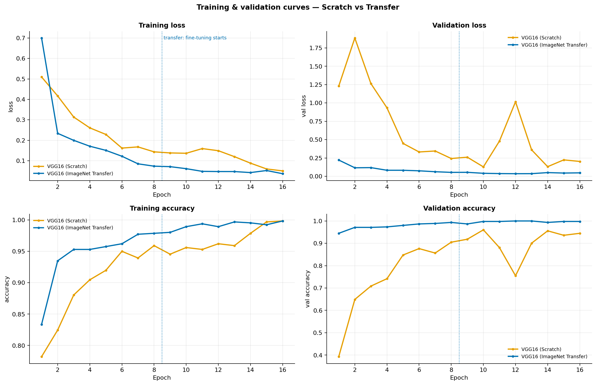

### 5.2 Generalization Gap & Training Speed
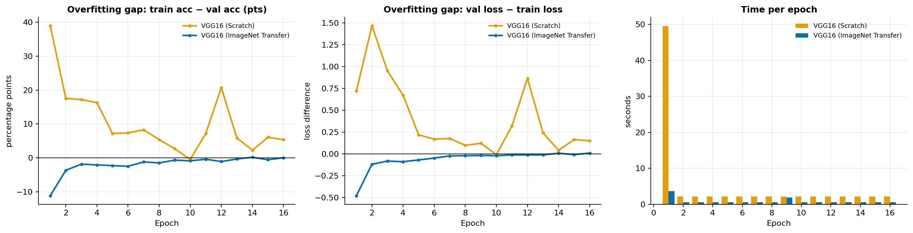

### 5.3 Test Metrics (Comparison)
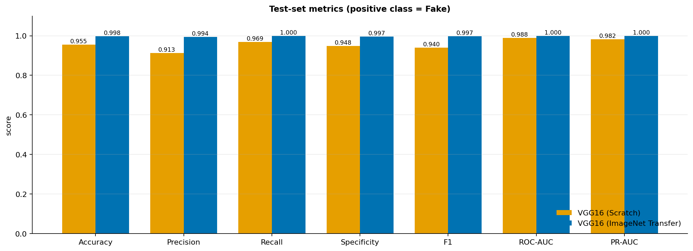

### 5.4 Confusion Matrices
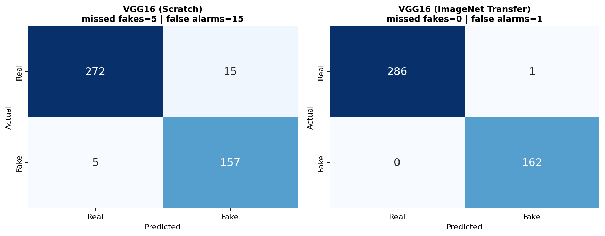

### 5.5 ROC, PR Curves & Threshold Analysis
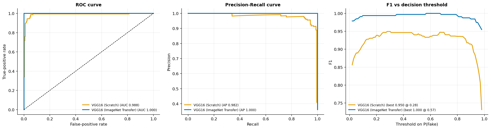

### 5.6 Predicted Score Separation
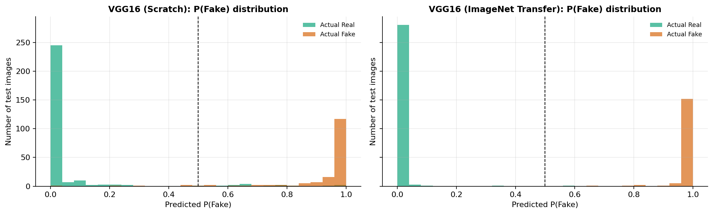

### 5.7 Efficiency (Time, Epochs, Parameters)
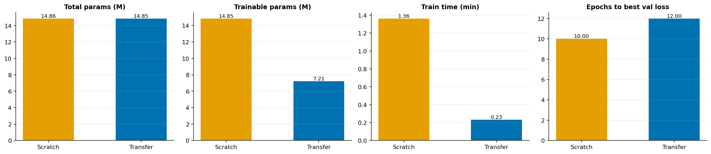

### 5.8 Disagreement Gallery (Discordant Predictions)
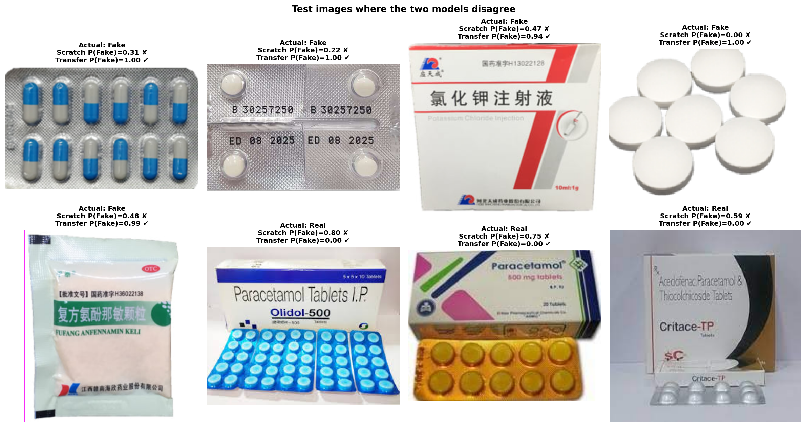

### 5.9 Discordant Samples (Close-up)
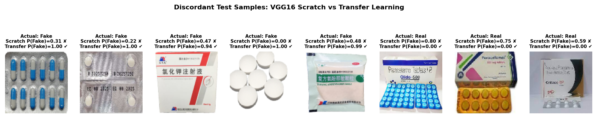

### 5.10 Evaluation Curves (Comparison)
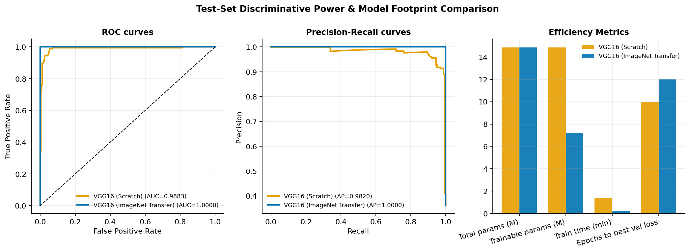

### 5.11 Learning Curves (Comparison)
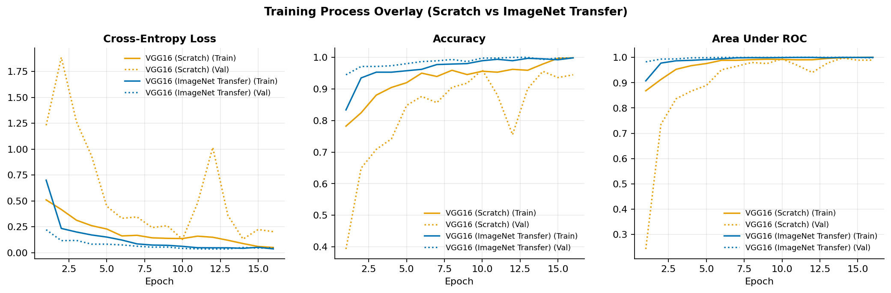

### 5.12 Scratch – Evaluation
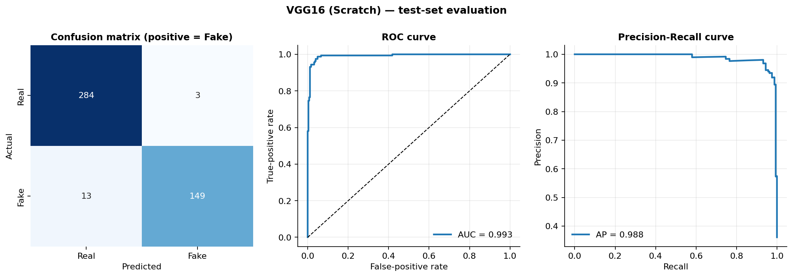

### 5.13 Scratch – Training Curves
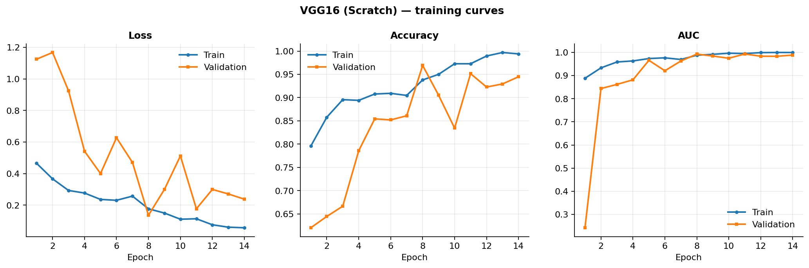

### 5.14 Transfer Learning – Evaluation
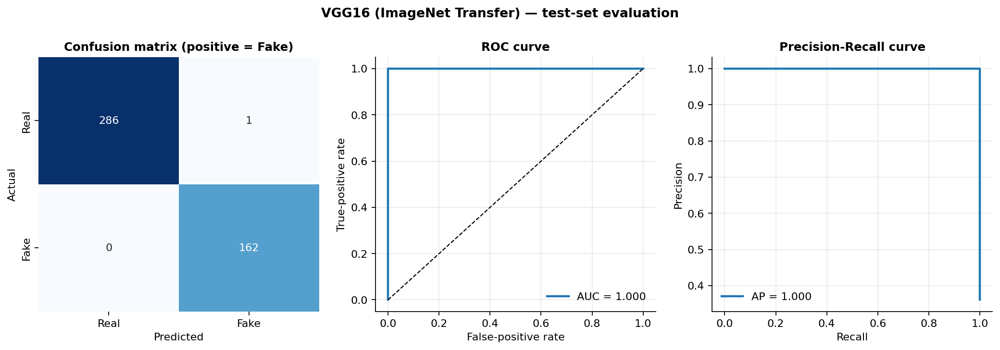

### 5.15 Transfer Learning – Training Curves
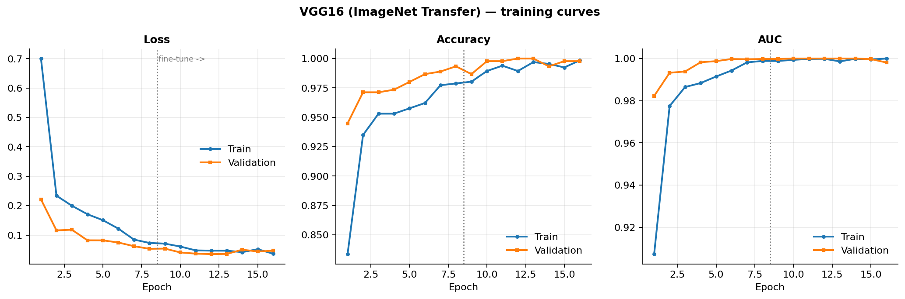

---

## 6. Key Insights

- **Safety First:** Eliminates FNs entirely (Recall=1.00) while reducing FPs — critical for counterfeit medicine detection.
- **Faster Convergence:** 4.9 min → 0.2 min (~24× faster) with stable optimization.
- **Better Generalization:** Smaller generalization gap, cleaner score separation, and fewer errors on discordant cases.
- **Statistically Robust:** McNemar test (p=2.098e-05) confirms significance.
- **Efficiency:** Fine-tuning head + Block 5 achieves superior performance with fewer trainable parameters vs. full end-to-end scratch training.

---

## 7. Result Artifacts Reference

| File | Description |
| --- | --- |
| [all_results.json](results/all_results.json) | Aggregated results and metadata for both runs. |
| [comparison_report.txt](results/comparison_report.txt) | Concise comparison summary. |
| [comparison_summary.csv](results/comparison_summary.csv) | High-level tabular comparison. |
| [vgg16_comparison_table.csv](results/vgg16_comparison_table.csv) | Detailed metric table. |
| [vgg16_scratch_history.csv](results/vgg16_scratch_history.csv) | Per-epoch training history (scratch). |
| [vgg16_scratch_meta.json](results/vgg16_scratch_meta.json) | Config, hyperparams, timings, params (scratch). |
| [vgg16_scratch_preds.npz](results/vgg16_scratch_preds.npz) | Test predictions/labels/probs (scratch). |
| [vgg16_transfer_history.csv](results/vgg16_transfer_history.csv) | Per-epoch training history (transfer). |
| [vgg16_transfer_meta.json](results/vgg16_transfer_meta.json) | Config, hyperparams, timings, params (transfer). |
| [vgg16_transfer_preds.npz](results/vgg16_transfer_preds.npz) | Test predictions/labels/probs (transfer). |

**Notebook:** [VGG16_Scratch_vs_Transfer_Comparison.ipynb](VGG16_Scratch_vs_Transfer_Comparison.ipynb)
